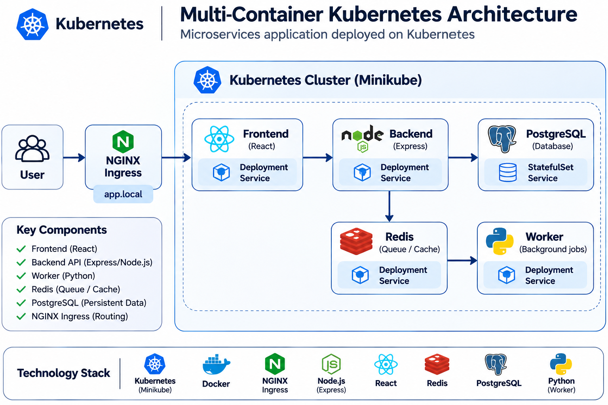

# Multi-Container Kubernetes Deployment

## Architecture




A multi-container application deployed using **Docker and Kubernetes**, demonstrating container orchestration, microservices communication, networking, and application deployment automation.


## Overview

This project demonstrates how to deploy and manage a distributed application using Kubernetes.

The architecture separates frontend, backend, background processing, and data storage into independently managed components.

## Tech Stack

- **Docker** — Containerization
- **Kubernetes** — Container orchestration
- **NGINX Ingress** — HTTP routing
- **React** — Frontend application
- **Node.js / Express** — Backend API
- **Redis** — Message processing and caching
- **PostgreSQL** — Persistent database
- **Minikube** — Local Kubernetes environment

## Architecture

```text
                Client / Browser
                       |
                       v
                  NGINX Ingress
                       |
             +---------+---------+
             |                   |
             v                   v
        React Client        Express API
             |                   |
             |             +-----+-----+
             |             |           |
             |             v           v
             |           Redis     PostgreSQL
             |             |
             |             v
             |        Worker Service
             |             |
             +-------------+
```

## Key Features

- Multi-container application architecture
- Kubernetes Deployments and Services
- Internal service-to-service communication
- NGINX Ingress routing
- Redis-based background processing
- PostgreSQL database integration
- Environment-based configuration
- Container lifecycle management
- Independent application component deployment

## Getting Started

### 1. Clone Repository

```bash
git clone https://github.com/Msrt12/multi-k8s.git
cd multi-k8s
```

### 2. Start Kubernetes

```bash
minikube start
minikube addons enable ingress
```

### 3. Configure Secrets

Create the required database credentials:

```bash
kubectl create secret generic pgpassword \
  --from-literal=PGPASSWORD=your-password
```

### 4. Deploy Application

```bash
kubectl apply -f k8s/
```

### 5. Verify Deployment

```bash
kubectl get pods
kubectl get deployments
kubectl get services
kubectl get ingress
```

### 6. Access Application

```bash
minikube ip
```

Use the Ingress endpoint to access the frontend application. Depending on the local Minikube driver, additional networking configuration may be required.

## Troubleshooting

Check running workloads:

```bash
kubectl get pods -o wide
```

Inspect logs:

```bash
kubectl logs <pod-name>
```

Check application events:

```bash
kubectl describe pod <pod-name>
```

## Cleanup

```bash
kubectl delete -f k8s/
```

## Skills Demonstrated

Kubernetes, Docker, Microservices Architecture, NGINX Ingress, Container Networking, Deployments, Services, Secrets, PostgreSQL, Redis, and Troubleshooting.

## Author

**Mykola Dmytrash**

- [GitHub](https://github.com/Msrt12)
- [Portfolio](https://msrt12.github.io/portfolio/)
